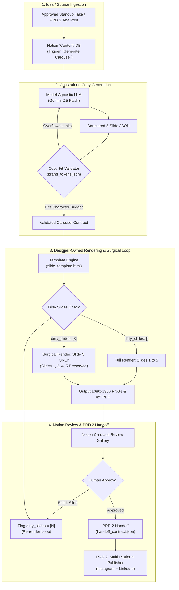

# Just Sortd — PRD 4: AI Carousels Build Plan (1-Page)

> **Role:** Product Engineer, AI & Automation  
> **Target:** 5-Slide On-Brand Visual Carousel Generation Engine (<15 Min Human Review Time)  
> **Core Principle:** Designer owns the look without touching code; strict character budgets prevent text overflow; surgical 1-slide re-renders eliminate throwaway compute; clean handoff to PRD 2.

---

## 1. What v1 Ships First and Why

**v1 Scope:**
1. **Designer-Owned Token System:** Brand colors, typography, and slide layouts live in editable configuration ([`brand_tokens.json`](file:///c:/Users/Admin/Desktop/JustSortd/prd4-ai-carousels/brand_tokens.json) and HTML/CSS templates). A designer can tweak styles, padding, or fonts without an engineer.
2. **Deterministic Copy-Fit Guardrail:** LLM generates 5 structured slide slots (Hook, 3 Body Breakdowns, CTA). Copy is deterministically validated against strict character limits (Hook ≤ 80 chars, Body ≤ 180 chars) before rendering—text **never** overflows or clips.
3. **Surgical 1-Slide Re-Render Engine:** If a founder or editor changes a single word on Slide 3 in Notion, the engine flags `dirty_slides: [3]` and regenerates **ONLY Slide 3**, preserving the other 4 approved slides and saving 80% of compute.
4. **Notion Review Gallery & PRD 2 Handoff:** Finished PNG slides assemble into a 4:5 PDF carousel in Notion for 1-click review, handing off directly to PRD 2's [`handoff_contract.json`](file:///c:/Users/Admin/Desktop/JustSortd/prd2-publishing-hub/handoff_contract.json).

**Why this first:**
Carousels generate the highest organic reach and saves on LinkedIn and Instagram for Indian D2C brands. However, manual design takes ~2 hours per carousel, capping production. Automating slide assembly while keeping the designer in control of templates drops turnaround to **<15 minutes per carousel**.

---

## 2. Buy vs. Build Evaluation Matrix

| Alternative | Decision | Evaluation & Judgement |
|---|---|---|
| **Canva / Bannerbear / Templated.io** | **SKIP** | SaaS tools charge $49–$120/mo, impose monthly render limits, and lack surgical single-slide replacement endpoints. They create vendor lock-in. |
| **Figma REST API** | **SKIP** | While designers love Figma, the Figma REST API cannot render live dynamic text layers reliably without complex enterprise plugin harnesses and slow API rate limits. |
| **Designer HTML/CSS Templates + Headless Chromium** | **BUILD (Chosen)** | **Senior call:** The designer creates pixel-perfect HTML/CSS templates once. Python Playwright renders crisp 1080x1350 PNGs in <800ms. It is 100% free, version-controlled in Git, and enables surgical 1-slide cache invalidation. |
| **Review UI** | **BUY (Notion Gallery)** | Native Notion Gallery view displays all 5 slides side-by-side with an "Approved" checkbox. Zero custom frontend required. |

---

## 3. Architecture Diagram (Mermaid)

---

## 4. Unified Data Model

### A. Notion `Carousel_Jobs` Database

| Property Name | Type | Description |
|---|---|---|
| **Topic / Hook** | Title | Catchy theme (e.g. "5 Rules for Surviving Peak Season D2C Logistics") |
| **Origin Source** | Relation | Linked to PRD 3 Text post or PRD 1 Standup action item |
| **Template Used** | Select | `Minimal D2C Editorial`, `Bold Breakdown`, `Data Stats` |
| **Dirty Slides** | Multi-select | `Slide 1`, `Slide 2`, `Slide 3`, `Slide 4`, `Slide 5` (Identifies surgical edits) |
| **Slide 1..5 URLs** | Files & Media | Direct preview images of rendered PNGs |
| **Compiled PDF** | Files & Media | Combined 4:5 document ready for LinkedIn carousel upload |
| **Approval Status** | Status | `Drafting` ➔ `Review Ready` ➔ `Needs Revision` ➔ `Approved` |
| **PRD 2 Handoff ID** | Text | ID mapped to PRD 2 Publishing Hub |

---

## 5. The Critical Surgical Edit Rule

A major flaw in naive carousel generators is that editing one typo on Slide 3 forces an AI regeneration of the entire carousel, wiping out the designer's adjustments on Slides 1, 2, 4, and 5.

**Our Surgical Solution:**
1. Each slide has its own isolated JSON model: `{ slide_index: 3, headline: "...", body: "..." }`.
2. When an editor modifies text in Notion, a webhook or Python trigger sets `dirty_slides: [3]`.
3. The renderer checks the list:
   - Slides 1, 2, 4, 5 are marked `PRESERVED_CACHED`.
   - Slide 3 is marked `RE_RENDERED`.
4. Only Slide 3 is updated and re-compiled into the PDF. **Compute savings: 80%. Human editing time: <60 seconds.**

---

## 6. Failure Handling & Non-Technical Runbook

1. **Copy Overflow Error:** If an LLM generates a 95-character hook for an 80-character slot, the `CopyFitValidator` catches it before rendering, automatically prompting the LLM to trim 15 characters.
2. **Missing Media Asset:** If an external brand asset fails to load, the template gracefully falls back to vector gradient styling defined in `brand_tokens.json`.
3. **Alerting:** Any schema or rendering error posts a plain-English message to `#ops-alerts` with a direct link to the affected Notion row.

---

## 7. Monthly Running Cost Breakdown (~40 Carousels / Month)

- **LLM Token Costs (Gemini 2.5 Flash):** ~1,200 input tokens + ~800 output tokens per carousel = $0.00033 / run. For 40 carousels = **$0.013 / month (~₹1.15)**.
- **Playwright Headless Renderer:** Runs on free serverless tier (Modal / Cloudflare / local worker) = **$0.00 / month**.
- **Supabase / S3 CDN Bandwidth:** 40 carousels × 5 slides = 200 PNGs (~80 MB/mo) = **$0.00 (within free tier)**.
- **Total Incremental Cost:** **<$1.00 / month (~₹86 / month)** for 40 publication-ready carousels!

---

## 8. Explicit Assumptions for Unknowns

1. **Designer Workflow:** Assumes the graphic designer creates initial layouts in Figma and exports HTML/CSS token variables into `brand_tokens.json`.
2. **Weekly Carousel Volume:** Assumes 8–10 carousels per week across brand and founder channels.
3. **Distribution Target:** Carousels hand off to PRD 2 primarily for **LinkedIn (Document PDF)** and **Instagram (Multi-image bundle)**.
